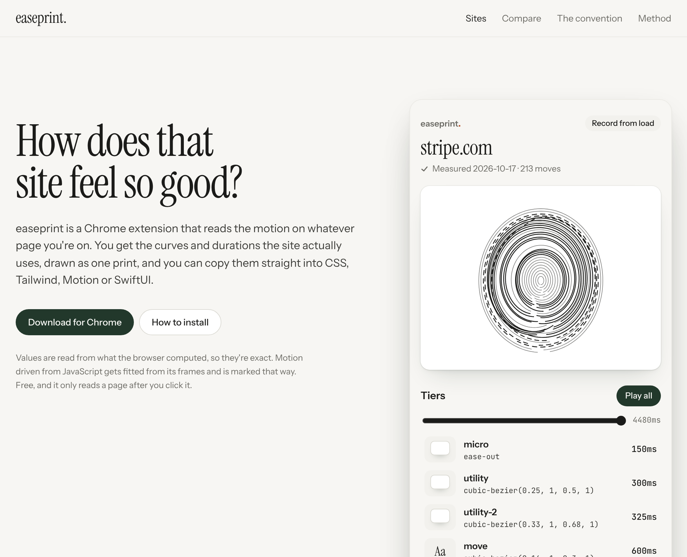
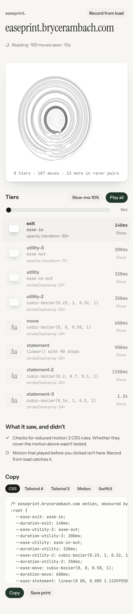
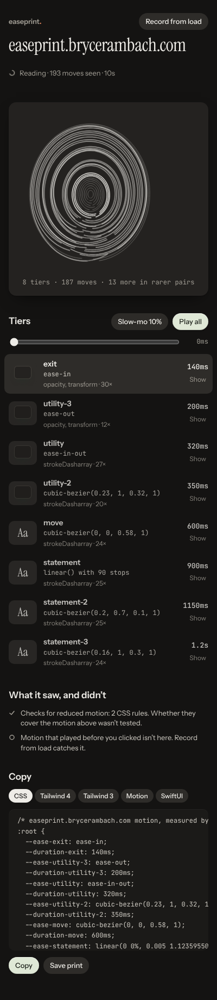

# easeprint

easeprint is a Chrome extension that reads how a site moves. Click it on any page and you get the curves and
durations that page actually uses, grouped into a few named tiers, drawn as one print, and ready to copy into CSS,
Tailwind, Motion or SwiftUI.

Live at [easeprint.brycerambach.com](https://easeprint.brycerambach.com).

## Why

When something on a site feels great, the only way to find out why is devtools: dig through computed styles, find
the transition, guess which of the five curves is the one that matters. Color pickers and font identifiers are
everywhere. I wanted the same thing for motion, and I wanted it to be honest about what it can't see.

## What it does

| Light | Dark |
|---|---|
|  |  |

- **Reads the page you're on.** CSS transitions and keyframe animations as they fire, Web Animations API calls,
  and every element's declared motion at rest. Values come straight from what the browser computed.
- **Catches JavaScript motion too.** GSAP, Motion springs and anything else on requestAnimationFrame never shows up
  in computed styles, so easeprint watches the element's style frame by frame and fits a curve to it. Fitted tiers
  are labeled, and springs that overshoot come out as `linear()` instead of a bezier that lies about them.
- **Names the tiers.** Near-identical pairs fold together and get named by job: micro, utility, move, statement,
  exit, loop.
- **Draws the print.** Each ridge is one tier. Distance from the core is its duration, the bulge along it is the
  curve, thicker ridges showed up more. The lines between are interpolated so it reads as one surface.
- **Lets you feel it.** Every tier runs on a small demo element with its exact timing. Scrub all of them together
  on one clock, slow everything to 10%, or hit Show to outline the real elements on the page, moving on that curve.
- **Copies it.** CSS custom properties, Tailwind 4 `@theme`, Tailwind 3 config, Motion presets or SwiftUI
  animations. Save print exports a 1080 x 1350 image with the tokens underneath.
- **Says what it missed.** Reduced-motion checks found, `transition: all`, canvas and WebGL, stylesheets from other
  domains it couldn't read, and motion that played before you clicked (Record from load catches that).

The site also has the original study: 20 sites measured with the Playwright reader in `scripts/measure.ts`, every
value traced to a raw file, with compare and convention pages.

## Install

It isn't on the Chrome Web Store yet.

1. Download [easeprint-extension.zip](https://easeprint.brycerambach.com/easeprint-extension.zip) and unzip it.
2. Open `chrome://extensions`, turn on Developer mode, click Load unpacked and pick the `easeprint` folder.
3. Click easeprint in the toolbar on any site, or press Alt Shift E.

## Status

v0.1. The extension and the site work and are tested. Not done yet: a Web Store listing, a public index where
your measurements can be published, `easeprint check` as a CLI and GitHub Action for motion lint, and a Claude
Code skill that writes a site's tiers into your codebase.

## FAQ

**What can it read?** Anything the browser computes: transitions, keyframe animations, the Web Animations API.
JavaScript motion is fitted from frames, which is close but not exact, and it says so on every fitted tier.

**What can't it read?** Motion inside a canvas or WebGL, scroll-linked motion (it follows your scroll, not a clock,
so it's left out on purpose), and anything that played before you clicked unless you use Record from load.

**What does it access?** Nothing until you click it. The click gives it the one tab you're on until you leave that
page (Chrome's `activeTab`). Record from load asks for one site at a time. Nothing leaves your browser.

**Is it exact?** For CSS and the Web Animations API, yes: it copies the browser's own strings. Tier names are
easeprint's, from duration bands and curve shape.

## Development

- `pnpm install`, then `pnpm dev` (http://localhost:4321) or `pnpm build` (builds the extension, then the site).
- `pnpm ext:build` bundles the extension to `extension/dist`. Load that folder unpacked while you work.
- `pnpm test` (vitest), `pnpm test:e2e` (the site in Playwright), `pnpm test:ext` (the extension in a real
  Chromium against `tests/fixtures/ext`), `pnpm lint`.
- `pnpm measure <url>` measures a site for the study; see `/method/` for what it does and can't see.

`src/lib/print/` is shared by the extension and the site: tiers, the print, the exporters and the curve fitter.
`PLAN.md` and `PROGRESS.md` are the original study's plan and evidence, `CLAUDE.md` the working rules.
